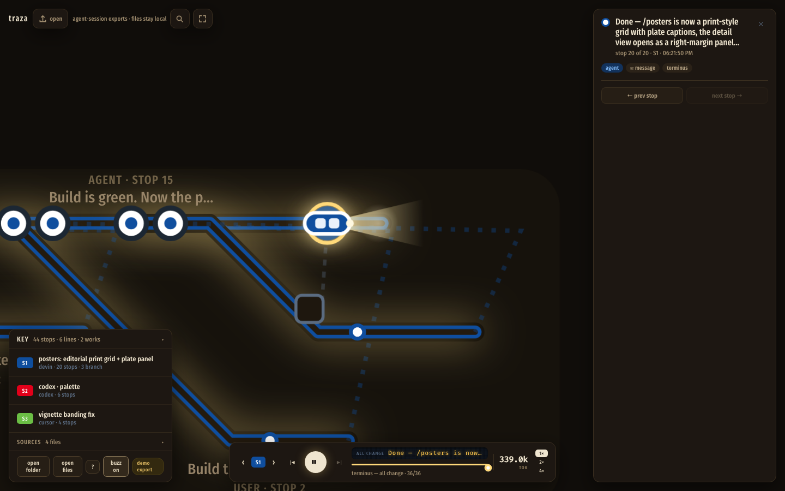

# traza

*the metro map of your agent sessions*

Drop an agent session export; traza draws it as the transit map of the
work — every step a station, every subagent a branch line — then lets you
ride the line and watch the session replay like a night service.



**[traza.vercel.app](https://traza.vercel.app)** — live, free, no account.
Everything happens in the browser; nothing leaves your machine.

## What it does

- **Plano.** A session becomes an octilinear metro map: the main run is
  the trunk line, each spawned subagent is a branch, work items hang off
  the nearest station as little works spurs, and stations you can read
  get their names up top — two-line labels (`ACTOR · STOP N`) at reading
  zoom.
- **Ride.** Press *follow the train* and the map dims to a warm sodium
  night while a train replays the session along its real route. The LED
  board morphs between stops; at the terminus the train parks, the
  corridor flares, and the board reads **ALL CHANGE**.
- **Explore.** Drag to pan, wheel/pinch to zoom, click stations and
  interchanges, seek anywhere on the ride timeline. The finder
  (`/` or ⌘K) flies to any station, corridor or work item by name.
- **Honest chrome.** First paint is the plano and the wordmark — the dock,
  tools and key only fade in once the opening camera beat lands, or the
  moment you take the camera yourself.

## What it reads

traza parses real session exports from the agent CLIs people actually
use:

- **Devin** — `nodes.jsonl` / ATIF session logs
- **Codex** — `rollout-*.jsonl` transcripts
- **Cursor** — decoded `messages.jsonl` exports
- **Anything text-shaped** — `.jsonl`, `.ndjson`, `.txt`, `.md`, `.log`,
  `.csv` fall through to a generic event stream parser

Drop a file, a folder, or a whole export directory. Three real sessions
ship as a demo so you can ride the plano before you have an export handy.

## How it works

- **Local-first.** Parsing, layout and rendering all happen client-side.
  There is no server, no account, no telemetry; secrets and paths are
  redacted before anything touches the DOM. `traza.html` in this repo is
  the whole product bundled into a single file — it runs from `file://`.
- **Map layout is real.** Stations, junctions and parallel corridors are
  solved by a dedicated graph pass (`src/lib/metro.ts`) that keeps every
  track octilinear and forward-only, then a label-placement pass that
  reserves collision boxes — including the sub-line strip — so names
  never tangle.
- **The ride follows geometry.** The train isn't animated along a
  timeline; it interpolates the actual track polylines
  (`src/lib/ride.ts`), so switches, merges and express skips are real.
- **Direct manipulation everywhere.** The camera is imperative: drag,
  wheel and pinch cancel flights, panning works while the inspector
  sheet is open, and on a phone the sheet springs between detents and
  flings away on a fast downward throw.

## Local run

```bash
npm install
npm run dev
```

Build + preview:

```bash
npm run build
npm run preview
```

Single-file artifact (what `traza.html` is):

```bash
npm run build:single   # writes dist-single/index.html
```

## Tests

```bash
node test/engine.mjs        # parsers + model
node test/metro.mjs         # layout invariants (octilinear, reachability, bounds)
node test/ride.mjs          # ride construction + interpolation
node test/render.mjs        # plano SVG render + PNG smoke
node test/live-check.mjs    # chromium + firefox + webkit: ride, selection, finder, night
node test/gesture-check.mjs # pan-while-open, fling-to-close, gesture-cancel of the opening dive
node test/perf-check.mjs    # 1200-step network, display-rate panning, reduced motion
```

## Stack

React 19 + TypeScript + Vite, hand-rolled SVG + imperative camera, zero
runtime dependencies beyond fonts and haptics. No map library, no
animation library — the whole thing is ~90 KB of product code.
